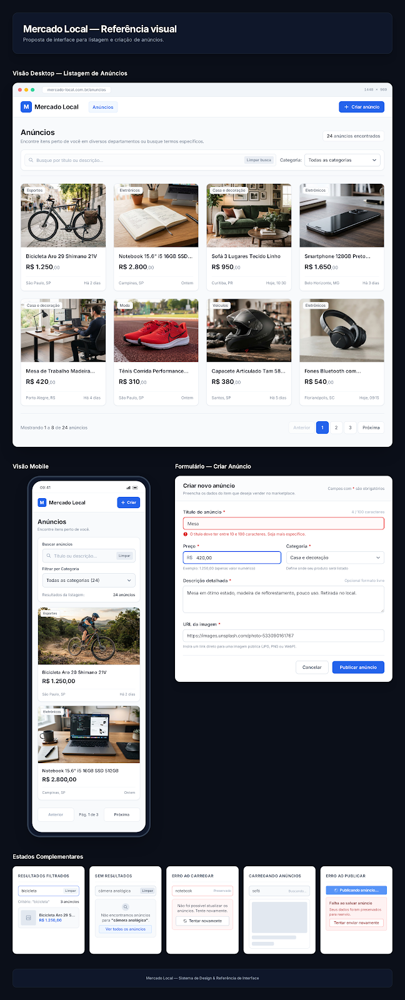

# Desafio Técnico — Frontend Web

## Objetivo

Construa a interface web de um **marketplace de anúncios**, onde pessoas podem publicar anúncios e consultar os já publicados.

A interface deve contemplar:

### 1. Listar anúncios

Permita que a pessoa consulte os anúncios fornecidos pela API.

A listagem deve oferecer:

- paginação;
- filtro por categoria;
- busca textual por título e descrição.

Busca, filtro e paginação devem funcionar em conjunto. As decisões de comportamento e apresentação ficam a seu critério.

### 2. Criar anúncio

Permita a criação de um anúncio com os campos e regras definidos no contrato da API.

A interface deve comunicar o resultado da operação e permitir que o anúncio criado seja encontrado posteriormente na listagem. A forma de integrar esses fluxos fica a seu critério.

### 3. Estados da interface

A referência visual sugere alternativas de experiência para lidar com os comportamentos da API. Fique à vontade para seguir essas sugestões, questioná-las ou propor caminhos que considere melhores, desde que consiga justificar suas escolhas.

## Referência visual

O [`handoff.png`](./handoff.png) apresenta uma proposta de interface para o desafio.

A imagem não é uma especificação nem um checklist. Os componentes, estados e comportamentos representados são exemplos. Você pode seguir a proposta, adaptá-la ou questioná-la, desde que atenda às capacidades obrigatórias do enunciado e consiga justificar suas escolhas.

## A API

Você vai consumir uma API local que fornecemos, na pasta [`api-mock`](../api-mock). **Comece pelo [guia para rodá-la](../api-mock/README.md)** e leia a [documentação](../api-mock/API.md), em especial a seção de comportamento operacional.

Trate a API como um serviço externo que você não controla. Não altere o código dela.

## Tecnologias

A escolha de linguagem, framework, bibliotecas e ferramentas é livre. A solução deve funcionar em um navegador e incluir instruções simples de execução.

## O que entregar

Siga as regras de entrega do [README principal](../../README.md): código funcional com instruções de execução, `DECISIONS.md`, `AI_USAGE.md` e testes dos fluxos críticos.

Sua aplicação deve ser utilizável em telas de celular e de computador, pense em todos os tipos de público e seja criativo para mostrar toda sua experiência deixando a pagina facil de acessar por qualquer um.
